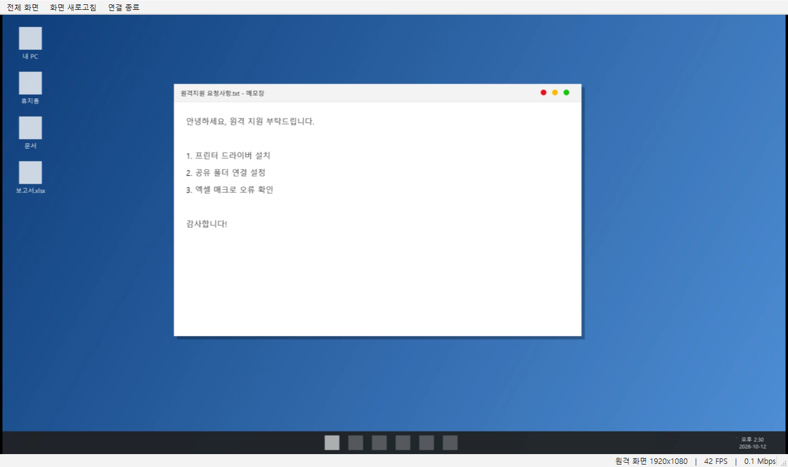
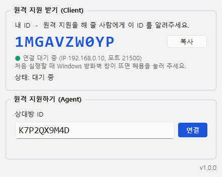
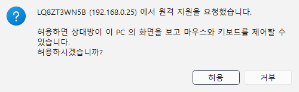
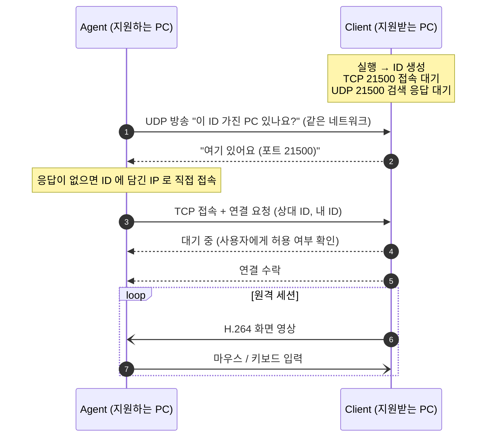

<div align="center">

# Window Remote

**서버 없이 exe 하나로 PC끼리 직접 연결하는 윈도우 원격 지원 프로그램**

[](https://github.com/Mithpasong/remote-desktop-window/releases/latest)
[](https://github.com/Mithpasong/remote-desktop-window/releases)


[](LICENSE)

### [⬇ WindowRemote-1.0.0.zip 다운로드](https://github.com/Mithpasong/remote-desktop-window/releases/download/v1.0.0/WindowRemote-1.0.0.zip)

<sub>압축을 풀고 <code>WindowRemote.exe</code> 를 실행하면 끝 · Python 설치 불필요 · <a href="https://github.com/Mithpasong/remote-desktop-window/releases">전체 릴리스 보기</a></sub>

<br>



</div>

---

## 목차

- [소개](#소개)
- [주요 기능](#주요-기능)
- [화면 구성](#화면-구성)
- [빠른 시작](#빠른-시작)
- [사용 방법](#사용-방법)
- [연결 원리](#연결-원리)
- [연결 가능한 네트워크](#연결-가능한-네트워크)
- [설정](#설정)
- [문제 해결](#문제-해결)
- [제한 사항](#제한-사항)
- [소스에서 실행 / 빌드](#소스에서-실행--빌드)
- [프로젝트 구조](#프로젝트-구조)
- [기술 상세](#기술-상세)
- [버전 기록](#버전-기록)
- [라이선스](#라이선스)

---

## 소개

Window Remote 는 Python 으로 만든 Windows 원격 지원 프로그램입니다.
**프로그램 하나에 두 가지 역할이 모두 들어 있어서**, 같은 exe 로 원격 지원을 받을 수도 있고 해 줄 수도 있습니다.

| 역할 | 하는 일 |
|---|---|
| **Client** — 원격 지원 받기 | 실행하면 10자리 ID 가 생기고 접속을 기다립니다(Listening). 이 ID 를 지원해 줄 사람에게 알려줍니다. |
| **Agent** — 원격 지원하기 | 상대방 ID 를 입력해 접속하고, 상대 PC 화면을 보면서 마우스·키보드로 제어합니다. |

중계 서버나 회원가입이 필요 없습니다. Agent 가 Client PC 에 **직접(P2P) 접속**합니다.

## 주요 기능

**화면 전송**
- H.264 영상 압축, **최대 60 FPS**
- 화면이 바뀔 때만 전송하므로 정지 화면에서는 데이터를 거의 쓰지 않음 (보통 2~4 Mbps)
- GPU 기반 화면 캡처 (DXGI Desktop Duplication), 실패 시 GDI 캡처로 자동 전환
- 2560×1440 보다 큰 화면은 비율을 유지하며 자동 축소 전송 (설정 가능)
- 창 크기에 맞춰 화면 자동 맞춤, 전체 화면 모드

**원격 입력**
- 마우스 이동 · 좌/우/가운데 클릭 · 더블클릭 · 휠 · 가로 휠 · 앞/뒤 버튼
- 키보드 전체 — 원격 창이 활성화되어 있으면 **Win 키, Alt+Tab, 한/영 키**까지 상대 PC 로 전달
- 창 밖으로 포커스가 나가거나 연결이 끊기면 눌린 키를 자동으로 해제 (키가 눌린 채로 남지 않음)

**연결**
- 실행할 때마다 새로 만들어지는 **10자리 ID** (영어 대문자 + 숫자)
- 같은 네트워크 자동 검색 + ID 에 담긴 IP 로 직접 접속
- 같은 PC 에서 여러 개 실행 가능 (포트 21500~21509 자동 선택)

**안전장치**
- 접속할 때마다 **지원받는 사람이 직접 허용**해야 연결됨 (55초 동안 응답 없으면 자동 거부)
- 원격 제어 중에는 화면 상단에 **빨간 알림 막대**가 항상 표시되고, 언제든 **연결 종료** 가능
- ID 전체가 정확히 일치해야 접속 가능 — IP 만 알아서는 접속할 수 없음

## 화면 구성

### 메인 창



- **원격 지원 받기 (Client)** — 내 ID, 접속 대기 상태(IP·포트), 현재 원격 상태
- **원격 지원하기 (Agent)** — 상대방 ID 입력 후 **연결**

### 접속 요청 확인 (지원받는 쪽)



Agent 가 접속하면 지원받는 쪽에 확인 창이 뜹니다. **허용**을 눌러야 연결됩니다.

### 원격 제어 중 알림 (지원받는 쪽)


원격 제어를 받는 동안 화면 맨 위 가운데에 항상 표시됩니다.

### 원격 화면 창 (지원하는 쪽)


- 도구 모음: **전체 화면** · **화면 새로고침** · **연결 종료**
- 상태 표시줄: 원격 화면 해상도, 실시간 FPS, 전송 속도

## 빠른 시작

1. **[WindowRemote-1.0.0.zip](https://github.com/Mithpasong/remote-desktop-window/releases/download/v1.0.0/WindowRemote-1.0.0.zip)** 을 받아 두 PC 에서 각각 압축을 풉니다.
2. 두 PC 모두 `WindowRemote.exe` 를 실행합니다.
   처음 실행할 때 **Windows 방화벽 창이 뜨면 "허용"** 을 누르세요.
3. 지원받는 PC 에 표시된 **내 ID** 를 지원하는 PC 의 **상대방 ID** 칸에 입력하고 **연결**.
4. 지원받는 PC 에서 **허용** → 원격 화면이 열립니다.

> 처음 실행할 때 **Windows SmartScreen** 경고("Windows의 PC 보호")가 뜰 수 있습니다.
> 코드 서명이 없는 exe 라서 정상이며, **추가 정보 → 실행** 을 누르면 됩니다.

## 사용 방법

### 지원받는 사람 (Client)

1. `WindowRemote.exe` 실행
2. 메인 창의 **내 ID** (예: `1MGAVZW0YP`) 를 지원해 주는 사람에게 알려줍니다. **복사** 버튼으로 클립보드에 복사할 수 있습니다.
3. 접속 요청 창이 뜨면 상대방 ID 를 확인하고 **허용**
4. 원격 지원을 끝내려면 화면 상단 알림 막대나 메인 창의 **연결 종료**

> 프로그램을 다시 실행하면 ID 가 바뀝니다. 지원받는 동안에는 프로그램을 켜 두세요.

### 지원하는 사람 (Agent)

1. `WindowRemote.exe` 실행
2. **상대방 ID** 에 전달받은 10자리 ID 입력 → **연결** (Enter 키도 가능)
3. "상대방의 수락을 기다리는 중..." 이 표시되면 상대방이 허용할 때까지 기다립니다. **취소**로 요청을 철회할 수 있습니다.
4. 원격 화면 창이 열리면 마우스·키보드로 조작합니다.

**원격 화면 창 사용 팁**

| 하고 싶은 것 | 방법 |
|---|---|
| 상대 PC 에 Win 키, Alt+Tab 보내기 | 원격 창을 클릭해 활성화한 상태에서 그대로 누르면 됩니다 |
| 내 PC 로 돌아오기 | 마우스로 원격 창 바깥을 클릭 (원격 창이 비활성화되면 키 입력은 내 PC 로) |
| 화면을 크게 보기 | 도구 모음의 **전체 화면** (다시 누르면 원래 크기) |
| 화면이 깨지거나 멈춘 것 같을 때 | **화면 새로고침** |
| 연결 끊기 | **연결 종료** 또는 창 닫기 |

## 연결 원리



### ID 구조

ID 는 영어 대문자와 숫자로 된 10자리(36진수)로, 약 51비트를 담습니다.

```
[ Client PC 의 IPv4 주소 (32비트, 무작위 값으로 섞음) ][ 무작위 값 (19비트) ]
```

- Agent 는 ID 에서 상대 PC 의 IP 를 복원해 **서버 없이** 직접 접속할 수 있습니다.
- 무작위 값이 실행할 때마다 바뀌고 IP 부분도 그 값으로 섞이므로, **ID 전체가 매번 달라집니다.**
- Client 는 접속 요청의 ID 가 자기 ID 와 정확히 같을 때만 허용 여부를 묻습니다. IP 만 알아서는 접속할 수 없습니다.

### 사용하는 포트

| 포트 | 용도 |
|---|---|
| TCP 21500 (~21509) | Agent → Client 접속, 화면·입력 데이터. 같은 PC 에서 여러 개 실행하면 다음 포트 사용 |
| UDP 21500 | 같은 네트워크에서 ID 로 PC 찾기 |

## 연결 가능한 네트워크

| 환경 | 연결 | 비고 |
|---|---|---|
| 같은 공유기 / 같은 사무실 네트워크 | ✅ | 자동 검색으로 바로 연결 |
| 사내망의 다른 서브넷 | ✅ | TCP 21500 이 통하면 ID 의 IP 로 연결 |
| VPN 으로 연결된 PC (회사 VPN, Tailscale, ZeroTier 등) | ✅ | VPN 이 기본 네트워크일 때 |
| 공인 IP 를 직접 받는 PC | ✅ | 방화벽에서 TCP 21500 허용 필요 |
| 인터넷 너머, 공유기(NAT) 뒤의 PC (예: 집 ↔ 회사) | ❌ | 중계 서버가 없으므로 직접 접속 불가 → **VPN 사용 권장** |

## 설정

설정 파일이 없어도 기본값으로 동작합니다. 바꾸고 싶을 때만 아래 위치에 `config.json` 을 만드세요.

1. `WindowRemote.exe` 와 같은 폴더의 `config.json` — 여러 PC 에 같은 설정으로 배포할 때
2. `%APPDATA%\WindowRemote\config.json` — PC 별 설정 (1번보다 우선)

```json
{
  "port": 21500,
  "fps": 60,
  "max_pixels": 3686400,
  "crf": 23,
  "max_bitrate_kbps": 15000
}
```

| 키 | 기본값 | 설명 |
|---|---|---|
| `port` | `21500` | 접속 대기 포트. **모든 PC 가 같은 값**이어야 합니다 |
| `fps` | `60` | 최대 전송 FPS |
| `max_pixels` | `3686400` (2560×1440) | 이보다 큰 화면은 비율을 유지해 축소 전송 |
| `crf` | `23` | 화질 — 낮을수록 고화질·고용량 (권장 18~30) |
| `max_bitrate_kbps` | `15000` | 최대 전송 비트레이트 (kbps) |

## 문제 해결

| 증상 | 원인과 해결 |
|---|---|
| **"상대 PC 에 연결할 수 없습니다"** | 상대 프로그램이 실행 중인지, 같은 네트워크(또는 VPN)인지 확인하세요. 상대 PC 방화벽에서 허용되지 않았을 가능성이 가장 큽니다 (아래 참고). |
| **"해당 ID 의 PC 를 찾을 수 없습니다"** | 상대 PC 에는 접속됐지만 ID 가 다릅니다. 상대가 프로그램을 다시 실행해 ID 가 바뀌었을 수 있습니다. |
| **"상대방 PC 가 이미 다른 원격 지원을 받고 있습니다"** | 한 번에 한 명만 원격 제어할 수 있습니다. |
| 방화벽 창에서 실수로 **취소**를 누름 | Windows 보안 → 방화벽 및 네트워크 보호 → **방화벽에서 앱 허용** → WindowRemote 체크 |
| 작업 관리자·설치 프로그램 등 관리자 창이 조작되지 않음 | Windows 보안 정책(UIPI) 때문입니다. 지원받는 쪽에서 `WindowRemote.exe` 를 **관리자 권한으로 실행**하세요. |
| 백신이 exe 를 차단 | PyInstaller 로 만든 원격 제어 프로그램은 오탐되기 쉽습니다. 백신 예외에 추가하세요. |
| 화면이 깨지거나 멈춤 | 원격 화면 창의 **화면 새로고침** |

**자가 진단** — 그 PC 에서 화면 캡처와 영상 인코딩이 되는지 확인합니다.

```bat
WindowRemote.exe --selftest
```

**로그 파일** — `%APPDATA%\WindowRemote\window_remote.log`

## 제한 사항

- 인터넷 너머 공유기(NAT) 뒤의 PC 와는 직접 연결할 수 없습니다 (VPN 필요).
- 주 모니터만 전송합니다.
- UAC 확인 창, 잠금 화면, Ctrl+Alt+Del 화면은 제어할 수 없습니다 (Windows 서비스 형태가 필요).
- 통신은 암호화되지 않습니다. 신뢰할 수 있는 네트워크에서 사용하세요.
- 상대 PC 의 마우스 커서 모양은 화면에 그려지지 않습니다 (내 마우스 커서로 조작).
- 클립보드 공유, 파일 전송은 아직 지원하지 않습니다.

## 소스에서 실행 / 빌드

**요구 사항**: Windows 10/11 (64비트), Python 3.13

```bat
git clone https://github.com/Mithpasong/remote-desktop-window.git
cd remote-desktop-window

python -m venv .venv
.venv\Scripts\pip install -r requirements.txt

:: 소스에서 바로 실행
.venv\Scripts\python main.py

:: exe 빌드 → dist\WindowRemote.exe
build.bat
```

`build.bat` 는 PyInstaller 로 단일 exe(약 80MB)를 만들며, `version_info.txt` 의 버전 정보(1.0.0)가 exe 속성에 들어갑니다.

## 프로젝트 구조

```
remote-desktop-window/
├─ main.py                  실행 진입점, 로그 설정, --selftest 자가 진단
├─ remote/
│  ├─ gui.py                메인 창 (내 ID, 상대 ID 연결, 접속 요청 확인, 알림 막대)
│  ├─ network.py            직접 연결 — Client 접속 대기·검색 응답, Agent 검색·접속
│  ├─ ids.py                ID 생성 (IP + 무작위 값 → 10자리) 및 해석
│  ├─ client_session.py     Client 세션 — 화면 캡처·인코딩·전송, 입력 주입
│  ├─ agent_viewer.py       Agent 원격 화면 창 — 디코딩·표시, 마우스·키보드 전송
│  ├─ capture.py            화면 캡처 (DXGI, 실패 시 GDI)
│  ├─ video.py              H.264 인코더 / 디코더
│  ├─ input_inject.py       SendInput 으로 마우스·키보드 입력 주입
│  ├─ keyhook.py            저수준 키보드 훅 (Win 키, Alt+Tab 등 시스템 키 전달)
│  ├─ protocol.py           메시지 형식, TCP 연결
│  └─ config.py             설정 로드 / 저장
├─ docs/images/             README 스크린샷
├─ build.bat                exe 빌드 스크립트
├─ version_info.txt         exe 버전 정보
├─ config.example.json      설정 파일 예시
└─ requirements.txt         의존 패키지
```

## 기술 상세

| 구성 요소 | 사용 기술 |
|---|---|
| GUI | PySide6 (Qt 6) |
| 화면 캡처 | [dxcam](https://github.com/ra1nty/DXcam) (DXGI Desktop Duplication), 대체 [mss](https://github.com/BoboTiG/python-mss) (GDI) |
| 영상 압축 | [PyAV](https://github.com/PyAV-Org/PyAV) (FFmpeg) — libx264 `ultrafast` + `zerolatency`, B-프레임 없음 |
| 입력 주입 | Win32 `SendInput` (ctypes) |
| 시스템 키 전달 | Win32 저수준 키보드 훅 `WH_KEYBOARD_LL` |
| 네트워크 | TCP (세션), UDP 방송 (검색) — 표준 라이브러리 `socket` |
| 배포 | PyInstaller 단일 exe |

**화면 전송 파이프라인**

```
[Client]  DXGI 캡처 (BGRA) → YUV420 변환·축소 → x264 인코딩 ─┐
                                                              │ TCP
[Agent]   화면 표시 ← 창 크기로 변환 (RGB) ← H.264 디코딩 ←──┘
```

- 화면 변화가 없으면 프레임을 보내지 않고, 새로고침 요청이나 해상도 변경 시 키프레임을 다시 보냅니다.
- 디코딩과 크기 변환은 백그라운드 스레드에서 처리해 GUI 가 끊기지 않습니다.
- 3440×1440 화면 기준 캡처~인코딩~디코딩이 프레임당 약 10ms 로, 60 FPS 를 유지합니다.

**메시지 형식** — 모든 메시지는 `[type 1바이트][length 4바이트][payload]` 형식입니다.

| 방향 | 메시지 |
|---|---|
| Client → Agent | `HELLO` (화면 정보 JSON), `VIDEO` (H.264 패킷) |
| Agent → Client | `MOUSE_MOVE`, `MOUSE_BUTTON`, `MOUSE_WHEEL`, `KEY`, `KEYFRAME_REQ` |
| 양방향 | `BYE` (연결 종료) |

마우스 좌표는 0~65535 로 정규화해 보내므로 양쪽 화면 해상도나 축소 전송과 상관없이 정확한 위치를 가리킵니다.

## 버전 기록

### 1.0.0 — 2026-10-12

- 첫 릴리스
- Client / Agent 통합 단일 exe
- 서버 없는 직접 연결 (IP 를 담은 10자리 ID, 같은 네트워크 자동 검색)
- H.264 최대 60 FPS 화면 전송, 마우스·키보드 원격 입력
- 접속 허용 확인, 원격 제어 중 알림 막대, `--selftest` 자가 진단

## 라이선스

[MIT License](LICENSE) © 2026 Mithpasong

누구나 자유롭게 사용·수정·배포(상업적 이용 포함)할 수 있습니다. 단, 소스를 재사용할 때는 저작권 표시와 라이선스 문구를 함께 포함해야 합니다.
